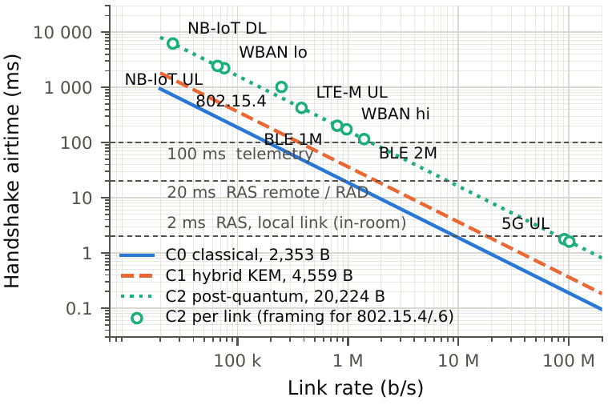

# pq-clinical-link-budget

**Does post-quantum key establishment fit clinical latency budgets?** A per-link budget of classical, hybrid
and fully post-quantum TLS 1.3 handshakes for Healthcare 5.0 wireless streams. Every input is a value quoted
from a public source, every derived number is produced by a script in this repository, and the transport
claims are checked on an OpenSSL 3.5 testbed.

**[Quick start](#quick-start)** · **[Results](#results)** · **[Reproduce everything](#reproduce-everything)** ·
**[Ledger](sources/README.md)** · **[Testbed](testbed/README.md)** · **[Datasets](data/README.md)**

<p align="center">
  
</p>
<p align="center"><sub>Handshake airtime versus link rate for C0 (classical), C1 (hybrid key exchange) and C2
(fully post-quantum), against the 3GPP medical latency budgets (paper, Fig. 1).</sub></p>

This is the companion repository of the paper *Can Post-Quantum Key Establishment Fit Clinical Latency
Budgets? A Per-Link Budget for Healthcare 5.0 Wireless Streams*.

## Configurations

| Name | Key exchange / authentication | Handshake bytes | Basis |
|---|---|---:|---|
| C0 | ECDHE / ECDSA P-256, mutual | 2,353 | measured (Tasopoulos et al., ISPEC 2022) |
| C1 | X25519MLKEM768 / ECDSA P-256 | 4,559 | derived: C0 with the hybrid key shares |
| C2 | Kyber-768 / Dilithium-3 (ML-KEM-768 / ML-DSA-65), mutual | 20,224 | measured (same source) |
| C2′ | C2 with server-only authentication | 11,654 | derived |
| C3 | ML-KEM-768 / Falcon-512 | testbed only | measured here |

## Results

**Bytes on air** (Table II of the paper: ms unless stated; every byte at the row's rate; last column: C0 / C2
within the 100 ms telemetry budget; `models/urllc_transmission.py`):

| Link | Rate | C0 | C1 | C2 | ≤ 100 ms |
|---|---:|---:|---:|---:|:---:|
| IEEE 802.15.4, 81 B per frame | 250 kb/s | 122 | 232 | 1.02 s | no / no |
| IEEE 802.15.6 narrowband, lowest rate | 75.9 kb/s | 278 | 501 | 2.23 s | no / no |
| IEEE 802.15.6 narrowband, highest rate | 971 kb/s | 22 | 39 | 174 | yes / no |
| Bluetooth LE 1M, application rate | 800 kb/s | 24 | 46 | 202 | yes / no |
| Bluetooth LE 2M, application rate | 1.4 Mb/s | 13 | 26 | 116 | yes / no |
| NB-IoT, uplink peak | 66 kb/s | 285 | 553 | 2.45 s | no / no |
| NB-IoT, downlink peak | 26 kb/s | 724 | 1.40 s | 6.22 s | no / no |
| LTE-M, uplink, half duplex | 380 kb/s | 50 | 96 | 426 | yes / no |
| 5G uplink, hospital private network (measured) | 91 Mb/s | 0.21 | 0.40 | 1.8 | yes / yes |
| 5G uplink, telesurgery (measured) | 101 Mb/s | 0.19 | 0.36 | 1.6 | yes / yes |

**Testbed** (Table IV of the paper: OpenSSL 3.5.4, cold connection, handshake bytes as TCP payload, median
time from connect to the first application record at the server, ms unless stated; TCP except the QUIC column,
which runs without Retry; 10 ms RTT on every link, assumed for LTE-M and NB-IoT; `models/testbed_tables.py`):

| Config. | Server flight (B) | Total (B) | 5G TCP | 5G QUIC | LTE-M | NB-IoT |
|---|---:|---:|---:|---:|---:|---:|
| C0 | 886 | 1,743 | 28.4 | 18.4 | 103 | 639 |
| C1 | 1,941 | 3,940 | 28.5 | 18.8 | 157 | 1.13 s |
| C2 | 10,275 | 20,608 | 30.9 | 32.4 | 574 | 4.89 s |
| C2′ | 10,200 | 11,641 | 29.1 | 30.2 | 377 | 3.72 s |
| C2 + one intermediate certificate per side | 15,806 | 31,670 | 48.8 | 43.7 | 851 | 7.36 s |
| C3 (Falcon-512) | 3,911 | 7,879 | 29.6 | 19.5 | 255 | 2.00 s |
| C3 + one intermediate certificate per side | 5,727 | 11,515 | 30.1 | 19.8 | 348 | 2.85 s |

In short:

- On constrained radios a full post-quantum handshake takes 0.12 to 6.2 s of airtime alone; against the 100 ms
  telemetry budget the verdict flips on 802.15.6 (highest rate), Bluetooth LE and LTE-M.
- On 5G uplinks the bytes serialize in under 2 ms and round trips bind, for classical handshakes too.
- The ML-DSA-65 server flight exceeds QUIC's anti-amplification allowance (one more round trip) and, with an
  intermediate certificate, TCP's initial window. A padded client Initial, a larger initial window or Falcon-512
  certificates avoid it.
- In two public mobility datasets the handover interruption alone exceeds 20 ms in 13,971 of 13,975 fully
  timestamped U.S. events, independently of cryptography, and the handshake's airtime at recorded throughput
  exceeds 2 ms in 15 % of U.S. and 76 % of Irish 5G samples.

## Quick start

Regenerates Tables I to IV of the paper and their JSON from the ledger and the stored testbed results. Python 3.9
or later, standard library only, no datasets, a few seconds:

```bash
git clone https://github.com/mnsh0409/pq-clinical-link-budget
cd pq-clinical-link-budget/models
python3 urllc_transmission.py && python3 mobility_handshake_budget.py && python3 tables.py && python3 testbed_tables.py
git status --short    # prints nothing: every regenerated file is identical to the committed one
```

## Reproduce everything

1. Install the analysis packages: `pip install -r requirements.txt`.
2. Fetch the two public datasets into `data/` (`data/README.md`; exact commits and a checksum are given).
3. Run all model scripts:

```bash
cd models
python3 build_ledger.py               # sources/*.md -> sources/ledger.json (only the build date changes)
python3 urllc_transmission.py         # airtime per link, first-flight bounds, computation -> results/urllc_transmission.json
python3 mobility_handshake_budget.py  # handshake cost per handover and session -> results/mobility_handshake_budget.json
python3 trace_profile.py              # profile of both datasets -> results/trace_profile.json
python3 figures.py                    # Fig. 1 and Fig. 2 -> paper/figs/, results/fig2_stats.json
python3 tables.py                     # Tables I-III -> paper/tables/
python3 testbed_tables.py             # Table IV and testbed summary -> paper/tables/tab4_testbed.tex, results/testbed_summary.json
```

A rerun from a clean checkout (2026-10-16), with the two datasets fetched as `data/README.md` describes,
reproduced every file in `results/` and `paper/tables/` byte for byte, except the last floating-point digit of
three means in `results/trace_profile.json` (summation order).

4. Optionally rerun the measurements: `testbed/README.md` (Linux with root; OpenSSL 3.5.4, and liboqs with
   oqs-provider for Falcon-512).

## Where each part of the paper comes from

| Paper | Script | Inputs |
|---|---|---|
| Table I (clinical streams) | `models/tables.py` | ledger |
| Table II (link classes and handshake airtime) | `models/tables.py` | `results/urllc_transmission.json` |
| Table III (handshake configurations) | `models/tables.py` | ledger |
| Table IV (testbed) and testbed text | `models/testbed_tables.py` | `results/testbed_x12.json` (TCP), `testbed_x4.json` (QUIC), `testbed_x3.json` (telemetry through outages) |
| Fig. 1 (airtime versus link rate) | `models/figures.py` | `results/urllc_transmission.json` |
| Fig. 2 and handover statistics | `models/figures.py` | DATA-01, DATA-02 -> `results/fig2_stats.json` |
| Testbed measurements | `testbed/x12.py`, `x4.py`, `x3.py` | ledger profiles; X3 also DATA-01 |

Any input number can be traced to its quoted source: `sources/README.md` shows how.

## Repository layout

```
sources/   parameter ledger (ledger.json) and the quoted evidence behind each entry (*.md)
models/    all arithmetic: link budgets, mobility statistics, tables, figures
results/   JSON outputs used in the paper
testbed/   TLS 1.3 / QUIC testbed over a user-space link emulator (experiments X1 to X4)
paper/     generated tables (LaTeX) and figures (PDF)
data/      instructions to fetch the two public datasets (nothing redistributed)
docs/      README figure
```

## Datasets

DATA-01 (Hassan et al., SIGCOMM 2022 artifact; no license stated in its repository) and DATA-02 (Raca et al.,
MMSys 2020; GPL-3.0) are analysed and cited, not redistributed.

## Scope and limitations

- Airtime is a lower bound: no MAC contention, acknowledgements, retransmissions or scheduling.
- The testbed checks the protocol and timing model, not a radio. The LTE-M and NB-IoT testbed profiles use an
  assumed 10 ms RTT, so those rows isolate serialization.
- Falcon-512 is the round-3 Falcon in oqs-provider 0.12.0 (experimental TLS code point); FN-DSA (FIPS 206) was
  not yet published when the experiments ran.
- Keys and certificates are generated locally (`testbed/pki/mkpki.sh`) and are not included.

## License

No license has been chosen yet. Until one is added, the contents are published for inspection and
reproduction of the paper's results.
