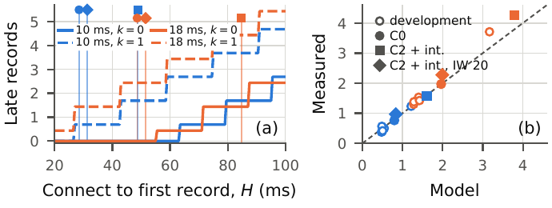

# pq-clinical-link-budget

**Does post-quantum key establishment fit clinical latency budgets?** A per-link budget of classical, hybrid
and fully post-quantum TLS 1.3 handshakes for Healthcare 5.0 wireless streams. Every input is a value quoted
from a public source, every derived number is produced by a script in this repository, and the transport
claims are checked on an OpenSSL 3.5 testbed.

**[Quick start](#quick-start)** · **[Results](#results)** · **[Reproduce everything](#reproduce-everything)** ·
**[Ledger](sources/README.md)** · **[Testbed](testbed/README.md)** · **[Datasets](data/README.md)**

<p align="center">
  
</p>
<p align="center"><sub>Handshake airtime versus link rate for C0 (classical), C1 (hybrid key exchange) and C2
(fully post-quantum), against the 3GPP medical latency budgets (the values are Table II of the paper).</sub></p>

This is the companion repository of the paper *Can Post-Quantum Key Establishment Fit Clinical Latency
Budgets? A Per-Link Budget for Healthcare 5.0 Wireless Streams*.

## Configurations

| Name | Key exchange / authentication | Handshake bytes | Basis |
|---|---|---:|---|
| C0 | ECDHE / ECDSA P-256, mutual | 2,353 | measured (Tasopoulos et al., ISPEC 2022) |
| C1 | X25519MLKEM768 / ECDSA P-256 | 4,559 | derived: C0 with the hybrid key shares |
| C2 | Kyber-768 / Dilithium-3 (ML-KEM-768 / ML-DSA-65), mutual | 20,224 | measured (same source) |
| C2′ | C2 with server-only authentication | 11,654 | derived |
| C3 | ML-KEM-768 / Falcon-512, mutual | testbed only | measured here |
| C3m | ML-KEM-768 / Falcon-512 server and CA, ML-DSA-65 device certificate | testbed only | measured here |

## Results

**Bytes on air** (Table II of the paper: ms unless stated; every byte at the row's rate; last column: airtime of
C0 / C1 / C2 below the 100 ms telemetry budget, n/a where the link cannot carry the 0.5 Mb/s telemetry stream;
`models/urllc_transmission.py`):

| Link | Rate | C0 | C1 | C2 | < 100 ms |
|---|---:|---:|---:|---:|:---:|
| IEEE 802.15.4, 81 B per frame | 250 kb/s | 122 | 232 | 1.02 s | n/a |
| IEEE 802.15.6 narrowband, lowest rate | 75.9 kb/s | 278 | 501 | 2.23 s | n/a |
| IEEE 802.15.6 narrowband, highest rate | 971 kb/s | 22 | 39 | 174 | yes / yes / no |
| Bluetooth LE 1M, application rate | 800 kb/s | 24 | 46 | 202 | yes / yes / no |
| Bluetooth LE 2M, application rate | 1.4 Mb/s | 13 | 26 | 116 | yes / yes / no |
| NB-IoT, uplink peak | 66 kb/s | 285 | 553 | 2.45 s | n/a |
| NB-IoT, downlink peak | 26 kb/s | 724 | 1.40 s | 6.22 s | n/a |
| LTE-M, uplink, half duplex | 380 kb/s | 50 | 96 | 426 | n/a |
| 5G uplink, hospital private network (measured) | 91 Mb/s | 0.21 | 0.40 | 1.8 | yes / yes / yes |
| 5G uplink, telesurgery (measured) | 101 Mb/s | 0.19 | 0.36 | 1.6 | yes / yes / yes |

**Testbed** (Table III of the paper: OpenSSL 3.5.4, cold connection, handshake bytes as TCP payload, median
time from connect to the first application record at the server, ms unless stated; TCP except the QUIC column,
which runs without Retry; 10 ms RTT on every link, assumed for LTE-M and NB-IoT; `models/testbed_tables.py`):

| Config. | Server flight (B) | Total (B) | 5G TCP | 5G QUIC | LTE-M | NB-IoT |
|---|---:|---:|---:|---:|---:|---:|
| C0 | 886 | 1,743 | 28.4 | 18.4 | 103 | 639 |
| C1 | 1,941 | 3,940 | 28.5 | 18.8 | 157 | 1.13 s |
| C2 | 10,275 | 20,608 | 30.9 | 32.4 | 574 | 4.89 s |
| C2′ | 10,200 | 11,641 | 29.1 | 30.2 | 377 | 3.72 s |
| C2 + one intermediate certificate per side | 15,806 | 31,670 | 48.8 | 43.7 | 851 | 7.36 s |
| C2 + intermediates, TCP initial windows of 20 segments (same keys and certificates) | 15,806 | 31,670 | 31.3 | n/a | 851 | 7.35 s |
| C3 (Falcon-512) | 3,911 | 7,879 | 29.6 | 19.5 | 255 | 2.00 s |
| C3 + one intermediate certificate per side | 5,727 | 11,515 | 30.1 | 19.8 | 348 | 2.85 s |
| C3m (Falcon-512 server, ML-DSA-65 device) | 3,914 | 11,598 | 30.4 | 19.8 | 338 | 2.49 s |
| C3m + one intermediate certificate per side | 5,727 | 15,226 | 29.9 | 19.9 | 429 | 3.32 s |

**Session loss at a handover** (Table IV of the paper: a 0.5 Mb/s telemetry stream, one 1,000-B record every
16 ms acknowledged by the server, 100 ms deadline from generation to receipt, through seven interruptions per
80-s run, five runs per condition, durations drawn from the measured NSA handover interruptions and the same in
every condition. Kept: the session survives and TCP retransmits; no detector. Lost: the emulator drops the old connection at
the interruption's start and the client, not told, follows one recovery policy chosen for this study: it declares
the loss after one probe timeout in the RFC 9002 form with a 25-ms margin, reconnects with each socket call bounded
by that timeout, and resends. Windows in which the host ran the emulator more than 15 ms late are excluded, 72 of
490, by `testbed/x3_qc.py`. Late: per condition, over its own valid windows (context only; the paper's Table IV
prints the differences and n). Difference: per interruption, late in the condition minus late in lost C0 on the
same interruption, averaged over the n windows valid in both, with a 95 % interval from a two-stage bootstrap
(runs, then interruptions); it is not the difference of the late values. No record was lost;
`models/testbed_tables.py`):

| Session, configuration | Late per interruption, 10 / 18 ms RTT | Difference from lost C0, 10 ms [95 % CI] (n) | 18 ms [95 % CI] (n) |
|---|---:|---|---|
| Kept (no detector) | 0.07 / 0.11 | −0.36 [−0.68, −0.05] (22) | −1.17 [−1.87, −0.61] (24) |
| Lost, C0 | 0.50 / 1.39 | reference | reference |
| Lost, C1 | 0.38 / 1.30 | −0.12 [−0.41, 0.19] (25) | −0.04 [−0.48, 0.46] (27) |
| Lost, C2 | 0.57 / 1.53 | 0.22 [0.04, 0.43] (23) | −0.19 [−1.08, 0.61] (26) |
| Lost, C2 + intermediates | 1.23 / 3.71 | 0.92 [0.43, 1.48] (24) | 2.29 [1.76, 2.88] (28) |
| Lost, C3m + intermediates | 0.39 / 1.38 | −0.04 [−0.48, 0.43] (23) | −0.07 [−0.44, 0.24] (27) |
| Resumed (psk_dhe_ke), C2 + intermediates | 0.42 / 1.42 | 0.00 [−0.42, 0.48] (24) | −0.10 [−0.37, 0.14] (29) |

**A model of the late records, tested on held-out runs** (Sec. V and Fig. 1 of the paper; `models/x3_model.py`).
Under the recovery policy above, a lost session keeps every record within 100 ms only if its cold
connect-to-first-record time H (median, Table III) is at most 100 ms − (k + 1) τ, with τ = RTT + 26.5 ms the timeout
once the RTT variation is small (0.5 ms of host turnaround assumed) and k the failed reconnection attempts: 63.5 and 55.5 ms at 10 and 18 ms RTT without a failed attempt, 27.0 and 11.0 ms
after one; one more record is late per 16 ms beyond the limit. The model has no parameter fitted to the telemetry
runs, but its form, the acknowledgment rule included, was fixed after seeing the development runs above (mean
absolute error 0.50 late records over their 363 lost-session windows). Its prediction for every interruption of five new seeds was written to
`results/testbed_x3_heldout_prereg.json` (SHA-256 `7fc547475ab5a242...`, written 2026-10-17 18:14:24 UTC) before those runs started; on
the 198 of 210 held-out windows the unchanged exclusion rule kept, its mean absolute error was 0.58 per window, and every
paired 95 % interval (and every t-interval over the five run means) contains its prediction:

| Held-out, lost session | Difference from lost C0, 10 ms [95 % CI] (n) | predicted | 18 ms [95 % CI] (n) | predicted |
|---|---|---:|---|---:|
| C2 + intermediates | 0.82 [0.46, 1.20] (34) | 0.81 | 2.30 [1.74, 2.84] (33) | 1.88 |
| C2 + intermediates, initial windows of 20 segments | 0.19 [−0.14, 0.49] (31) | 0.00 | 0.21 [−0.29, 0.87] (28) | 0.00 |

With the window and the same keys and certificates, no chain penalty is detectable (upper bounds 0.49 and
0.87; equivalence not tested); against the default window it changed the late records by −0.66 [−0.97, −0.35] and
−2.18 [−2.78, −1.64] (n = 32 and 28; predicted −0.83 and −1.88). It does not remove the cost of the recovery policy: with
it, as with C0, every late record falls in a window with a failed reconnection attempt. Weak points: the model
underestimates C2 + intermediates at 18 ms by about half a record (development and held-out alike) and misses the
0.22 of C2 with leaf certificates at 10 ms in the development runs (0 predicted); the window runs hold
9 of the 12 excluded held-out windows, whose host stalls all came 0.7 to 8.3 s after the onset, after the
reconnection, yet the 18 ms window results rest on that exclusion (with all windows: 1.54 [−0.06, 4.91] against C0, −0.86 [−2.34, 2.17] against the default window).
The window's cost is a first burst of up to 20 segments on both endpoints, the device included, where RFC 6928
allows 10.

<p align="center"></p>

In short:

- On constrained radios a full post-quantum handshake takes 0.12 to 6.2 s of airtime alone. On the links that can
  carry the 100 ms telemetry stream (802.15.6 at its highest rate, Bluetooth LE) the airtime of C0 and C1 fits
  that budget and that of C2 (116 to 202 ms) does not; with its ML-KEM-768 computation C1 reaches 82 to 102 ms.
- On 5G uplinks the bytes serialize in under 2 ms and round trips bind, for classical handshakes too.
- The ML-DSA-65 server flight exceeds QUIC's anti-amplification allowance (one more round trip) and, with
  intermediate certificates, the server and client flights exceed TCP's initial window. Falcon-512 server
  certificates (with the device keeping ML-DSA-65, C3m) avoid both in the testbed, and so do TCP initial windows of
  20 segments with the ML-DSA-65 chain unchanged; a padded QUIC client Initial should too (not measured).
- Under the recovery policy used here, a session lost at a handover costs telemetry deadlines even with a
  classical handshake (1.17 more late records per interruption than a kept session at 18 ms RTT; the gap combines
  losing the session with this one policy): detection (median 38 to 47 ms after the onset) fires before the
  interruption ends in 71 % (10 ms) and 57 % (18 ms) of lost-session windows, and every failed reconnection
  attempt was a connection request sent into the interruption. Against classical reconnection under the same
  policy, ML-DSA-65 chains with intermediates add 0.92 (10 ms) and 2.29 (18 ms) late records per interruption;
  C1, Falcon-512 server and CA certificates (C3m) and resumption differ from it by −0.12 to 0.00, with intervals
  that include zero (equivalence not tested). No record was lost in any condition.
- A model of the late records, with predictions filed before held-out runs, predicted the chain's penalty, and a
  20-segment initial window left none detectable; after one failed reconnection attempt at 18 ms RTT even a
  classical reconnection leaves two or three records late, which only the recovery policy can avoid.
- In a public mobility dataset the handover interruption alone exceeds 20 ms in 13,971 of 13,975 fully
  timestamped U.S. events, independently of cryptography (the throughput-proxy and Irish trace statistics of
  earlier versions stay in `results/fig2_stats.json`).

## Quick start

Regenerates Tables I to IV of the paper and their JSON from the ledger and the stored testbed results. Python 3.9
or later, no datasets, a few seconds; `testbed_tables.py` (Tables III and IV) needs numpy for the seeded bootstrap
of Table IV (tested with numpy 2.4.4), the other scripts only the standard library:

```bash
git clone https://github.com/mnsh0409/pq-clinical-link-budget
cd pq-clinical-link-budget/models
python3 urllc_transmission.py && python3 mobility_handshake_budget.py && python3 tables.py && python3 testbed_tables.py
git status --short    # prints nothing: every regenerated file is identical to the committed one
```

## Reproduce everything

1. Install the analysis packages: `pip install -r requirements.txt`.
2. Fetch the two public datasets into `data/` (`data/README.md`; exact commits and a checksum are given).
3. Run all model scripts:

```bash
cd models
python3 build_ledger.py               # sources/*.md -> sources/ledger.json (only the build date changes)
python3 urllc_transmission.py         # airtime per link, first-flight bounds, computation -> results/urllc_transmission.json
python3 mobility_handshake_budget.py  # handshake cost per handover and session -> results/mobility_handshake_budget.json
python3 trace_profile.py              # profile of both datasets -> results/trace_profile.json
python3 figures.py                    # handover statistics -> results/fig2_stats.json (and the airtime and CDF figures of earlier versions)
python3 tables.py                     # Tables I and II -> paper/tables/
python3 testbed_tables.py             # Tables III and IV, model and held-out scoring -> paper/tables/tab4_testbed.tex, tab5_session.tex, results/testbed_summary.json
python3 fig_model.py                  # Fig. 1 (model) -> paper/figs/fig3_model.pdf
```

A rerun from a clean checkout (2026-10-16), with the two datasets fetched as `data/README.md` describes,
reproduced every file in `results/` and `paper/tables/` byte for byte, except the last floating-point digit of
three means in `results/trace_profile.json` (summation order).

4. Optionally rerun the measurements: `testbed/README.md` (Linux with root; OpenSSL 3.5.4, and liboqs with
   oqs-provider for Falcon-512).

## Where each part of the paper comes from

| Paper | Script | Inputs |
|---|---|---|
| Table I (clinical streams) | `models/tables.py` | ledger |
| Table II (link classes and handshake airtime) | `models/tables.py` | `results/urllc_transmission.json` |
| Table III (testbed) and testbed text | `models/testbed_tables.py` | `results/testbed_x12.json` (TCP, including the 20-segment initial window), `testbed_x4.json` (QUIC), `testbed_timeline.json` (TCP flight timeline) |
| Table IV (session loss at a handover) | `models/testbed_tables.py` | `results/testbed_x3.json`, `results/testbed_x3_qc.json` (host-stall windows); held-out rows: `testbed_x3_heldout.json`, `testbed_x3_heldout_qc.json`, `testbed_x3_heldout_prereg.json` |
| Fig. 1 (model of the late records) and its paragraph | `models/x3_model.py`, `models/fig_model.py`, `models/testbed_tables.py` | `results/testbed_summary.json` (`x3_model`); predictions filed by `models/x3_prereg.py` |
| Handover statistics (Sec. V) | `models/figures.py` | DATA-01 (DATA-02 only for statistics outside the paper) -> `results/fig2_stats.json` |
| Testbed measurements | `testbed/x12.py`, `x4.py`, `x3.py`, `x3_qc.py`, `timeline.py` | ledger profiles; X3 also DATA-01 |

Any input number can be traced to its quoted source: `sources/README.md` shows how.

## Repository layout

```
sources/   parameter ledger (ledger.json) and the quoted evidence behind each entry (*.md)
models/    all arithmetic: link budgets, mobility statistics, tables, figures
results/   JSON outputs used in the paper
testbed/   TLS 1.3 / QUIC testbed over a user-space link emulator (experiments X1 to X4)
paper/     generated tables (LaTeX) and figures (PDF)
data/      instructions to fetch the two public datasets (nothing redistributed)
docs/      README figure
```

## Datasets

DATA-01 (Hassan et al., SIGCOMM 2022 artifact; no license stated in its repository) and DATA-02 (Raca et al.,
MMSys 2020; GPL-3.0) are analyzed and cited, not redistributed.

## Scope and limitations

- Airtime is a lower bound: no MAC contention, acknowledgments, retransmissions or scheduling.
- The testbed checks the protocol and timing model, not a radio. The LTE-M and NB-IoT testbed profiles use an
  assumed 10 ms RTT, so those rows isolate serialization.
- Falcon-512 is the round-3 Falcon in oqs-provider 0.12.0 (experimental TLS code point); FN-DSA (FIPS 206) was
  not yet published when the experiments ran.
- Session loss is modeled as a silent drop of the old connection, recovered by one detector and retry policy;
  the gap between a kept and a lost session belongs to that policy (a client that cannot tell whether its
  session survived and runs the same detector pays the lost-session cost whenever the detector fires).
- Keys and certificates are generated locally (`testbed/pki/mkpki.sh`) and are not included.

## License

No license has been chosen yet. Until one is added, the contents are published for inspection and
reproduction of the paper's results.
